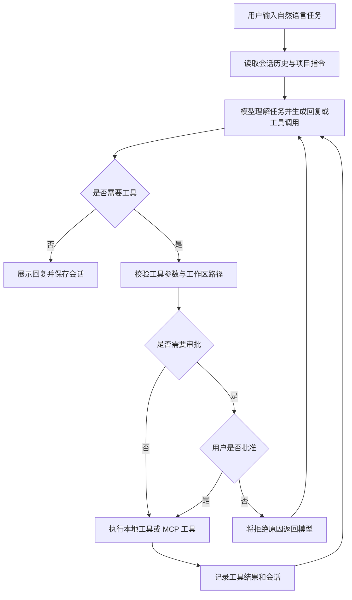

| 这个作业属于哪个课程 | [计科 24 级 56 班](https://edu.cnblogs.com/campus/gdgy/Class56-Grade2024-CS/) |
|-------------------|-----------------|
| 这个作业要求在哪里 | [构建一个能说会做的智能体](https://edu.cnblogs.com/campus/gdgy/Class56-Grade2024-CS/homework/16760) |
| 这个作业的目标 | 实现一个能够理解自然语言、调用工具处理文件和执行命令，并记住多轮对话的编程与办公助手。 |
| 学号 | 3124004049、3124004064（廖程东） |

# 构建一个能说会做的智能体：Aria

[返回作业目录](../README.md) · [仓库首页](../../README.md)

## 1. 项目简介

Aria 是一个基于 Python 的终端 Coding Agent，面向编程与文件整理场景，能够通过自然语言理解用户任务，并调用文件、搜索、编辑和命令工具完成操作。

项目围绕“模型理解任务 → 调用工具 → 分析执行结果 → 回复用户”的循环设计，将模型接入、工具调度、权限审批、会话存储和终端界面划分为独立模块。用户既可以直接提问，也可以让智能体创建文件、修改内容和执行命令。

GitHub 仓库：[onychen/gdut-software-engineering-2026](https://github.com/onychen/gdut-software-engineering-2026)，项目目录：`3124004049/aria/`。

## 2. 需求描述

面向需要通过自然语言阅读、整理和修改项目文件的用户。用户给出任务后，智能体自行决定是否调用工具，把工具执行结果继续交给模型分析，最后说明完成情况。

| 需求 | 实现方式 | 对应代码 |
| --- | --- | --- |
| 自然语言对话（会说） | OpenAI-compatible 模型接口、流式回复与推理展示 | `src/core/openai_client.py`、`src/core/ui.py` |
| 执行操作（会做） | 文件列举、搜索、读取、创建、编辑和本地命令执行 | `src/core/tools/` |
| 多轮记忆 | JSONL 会话保存、历史恢复和上下文压缩 | `src/core/session.py`、`src/core/session_store.py`、`src/core/context.py` |
| 外部工具扩展 | 可选 stdio MCP 客户端，支持工具发现与调用 | `src/core/tools/mcp_stdio.py` |
| 简洁交互界面 | 全屏终端界面，显示 Markdown、工具执行和审批操作 | `src/core/screen.py`、`src/core/tool_approval.py` |
| 控制写入与执行 | 写文件、编辑文件和执行命令前请求用户确认 | `src/core/tools/permissions.py` |

本项目提供终端界面；没有实现语音输入输出、网页或桌面图形界面，也没有内置天气或数据库服务。MCP 是可选扩展能力，基础文件任务不依赖额外 MCP Server。

## 3. 业务流描述



例如，用户要求“把会议记录整理成待办清单”，模型先调用读取工具获取文件，再调用写入工具生成清单。用户批准写入后，执行结果返回模型，由模型说明输出文件位置。路径校验或工具执行失败时，错误同样会返回模型，支持后续纠正。

## 4. 实现说明

采用 Python 3.11+，主要依赖为 OpenAI Python SDK、prompt-toolkit 和 Pygments；测试使用 pytest 与 pytest-asyncio。完整依赖声明在 `pyproject.toml`，固定版本在 `uv.lock`。

```text
aria/
├── src/core/               # 模型、Agent 循环、会话、界面、命令与工具
│   ├── agent_loop.py       # 模型 → 工具 → 模型循环
│   ├── prompts/            # Agent 与上下文压缩提示词资源
│   ├── tools/              # 本地工具、权限、MCP 接入
│   └── commands/           # /model、/compact、/mcp 等命令
├── tests/                  # 自动化测试
├── evaluation/             # 离线回归与可选真实模型评测
├── examples/               # 无真实密钥的配置模板与演示输入
├── evidence/               # 测试与功能验证结果
├── design/                 # 架构与模块设计资料
├── problems/、todo/        # 实验分析与待办记录
├── pyproject.toml
├── uv.lock
└── README.md               # 项目说明与使用文档
```

`main.py` 负责启动，`ui.py` 负责编排用户交互，`screen.py` 负责渲染，`agent_loop.py` 驱动模型与工具循环。工具通过统一注册表调度，权限判断与审批界面分离。会话和工具结果写入工作区的 `.aria/`，恢复时重新载入历史消息。

MCP 接入使用标准输入输出与外部 Server 通信，完成初始化、`tools/list` 工具发现和 `tools/call` 调用，再统一交给工具管理器调度。可选配置说明见 [MCP 示例](./examples/README.md)。

## 5. 安装与运行

需要 Python 3.11+、Git、uv 和 ripgrep（`rg` 命令，供文件搜索工具使用）。完整自动化验证在 WSL Ubuntu 下完成；部分命令测试使用 POSIX Shell，Windows 用户进行完整复现时建议使用 WSL。

Ubuntu 可先安装搜索工具：

```bash
sudo apt-get update
sudo apt-get install ripgrep
rg --version
```

```bash
git clone https://github.com/onychen/gdut-software-engineering-2026.git
cd gdut-software-engineering-2026/3124004049/aria
uv sync --frozen
uv run aria
```

首次运行会引导选择模型服务商、填写 API Key 和模型名称，并将配置保存到用户目录 `~/.aria/settings.json`。模型须支持工具调用；上下文窗口以实际模型配置为准。

也可复制 `examples/settings.example.json` 到项目 `.aria/settings.json`，填写真实配置后显式启动：

```bash
mkdir -p .aria
cp examples/settings.example.json .aria/settings.json
# 编辑 .aria/settings.json，填写服务地址、模型名称、API Key 和上下文窗口。
uv run aria --config .aria/settings.json
```

示例中的域名、模型名和密钥均为占位内容，不能直接连接模型。`.aria/` 已被忽略，勿将真实密钥写入示例文件。

常用操作：`Enter` 发送，`Ctrl+J` 换行，`Esc` 取消请求，`Ctrl+D` 退出。输入 `/` 可以选择 `/model`、`/compact`、`/status`、`/mcp`、`/export` 等命令。写操作审批支持批准本次、批准本会话或拒绝。

## 6. 使用示例与功能演示

以下为可复现的演示步骤和预期结果；真实模型演示需要自行配置有效服务。自动化验证使用离线模型替身，实际验证结果见 [测试与功能验证记录](./evidence/README.md)。

### 示例一：自然语言创建文件

启动 Agent 后输入：

```text
请读取 examples/demo-workspace/meeting-notes.txt，把三个任务整理成 Markdown 复选框清单，写入 examples/demo-workspace/TODO.md。保留负责人和截止日期，完成后说明输出路径。
```

预期过程：读取会议记录 → 生成写入请求 → 用户批准 → 创建 `TODO.md` → 返回完成说明。可以直接打开文件核对三个任务及负责人、日期。生成的 `TODO.md` 已加入忽略规则。

### 示例二：多轮对话和修改文件

继续输入：

```text
把刚才清单中廖程东负责的“执行测试与整理演示证据”标为已完成，其余任务保持不变，并读取修改后的文件确认。
```

预期过程：利用会话历史定位刚才的文件 → 读取与编辑 → 用户批准 → 再次读取确认。此过程同时展示对话记忆与工具执行。

### 示例三：退出后恢复

```bash
uv run aria resume
uv run aria resume <session-id>
```

不带 ID 时选择历史会话；带 ID 时恢复指定会话。退出时会显示恢复命令。恢复后可继续询问上一轮创建的清单。

### 示例四：执行命令

```text
请运行 python --version，并告诉我当前 Python 版本。
```

批准命令后，Agent 根据真实命令输出回答版本。需要演示 MCP 时，可按 `examples/README.md` 配置自己的 Server，再使用 `/mcp` 查看状态。

## 7. 测试与验证

从本项目目录执行：

```bash
uv run --frozen pytest -q
uv run --frozen python -m evaluation.runner
uv run --frozen aria --help
```

离线评测覆盖多轮记忆、文件编辑、工具失败恢复、上下文压缩恢复、取消后的会话恢复和模型重试六种场景，不需要 API Key。默认输出到被忽略的 `evaluation-results/`。

验证结果为 910 项测试通过、1 项因缺少 TypeScript 编译器跳过，六项离线评测场景全部通过。测试日志与评测报告保存在 [evidence/](./evidence/)。

## 8. 小组分工安排

| 成员 | 分工 | 交付内容 |
| --- | --- | --- |
| 3124004049 | 负责 Agent 核心流程、模型接入、文件与命令工具，以及配置与运行说明 | 可运行项目、需求与业务流说明、实现说明 |
| 3124004064 廖程东 | 负责测试复现、功能演示、MCP 接入验证与博客材料整理 | 测试记录、实际演示截图或视频、小组心得整理 |

以上为本次作业的任务安排，最终提交时请按实际完成情况更新。

## 9. 成员心得（待本人补充）

### 3124004049

待本人填写：结合 Agent 架构设计与工具循环的理解，记录实际遇到的问题、解决过程和收获。

### 3124004064 廖程东

待本人填写：结合测试、会话恢复、工具审批和演示过程，记录实际观察和改进建议。

## 10. 博客提交材料

本 README 已按作业要求在最前面附上课程信息表，包含需求、业务流、实现、示例、GitHub 链接和分工安排，可作为博客正文基础。发布前由成员补齐各自心得与真实模型演示截图或视频；博客园发布和课程平台提交需由小组完成。
